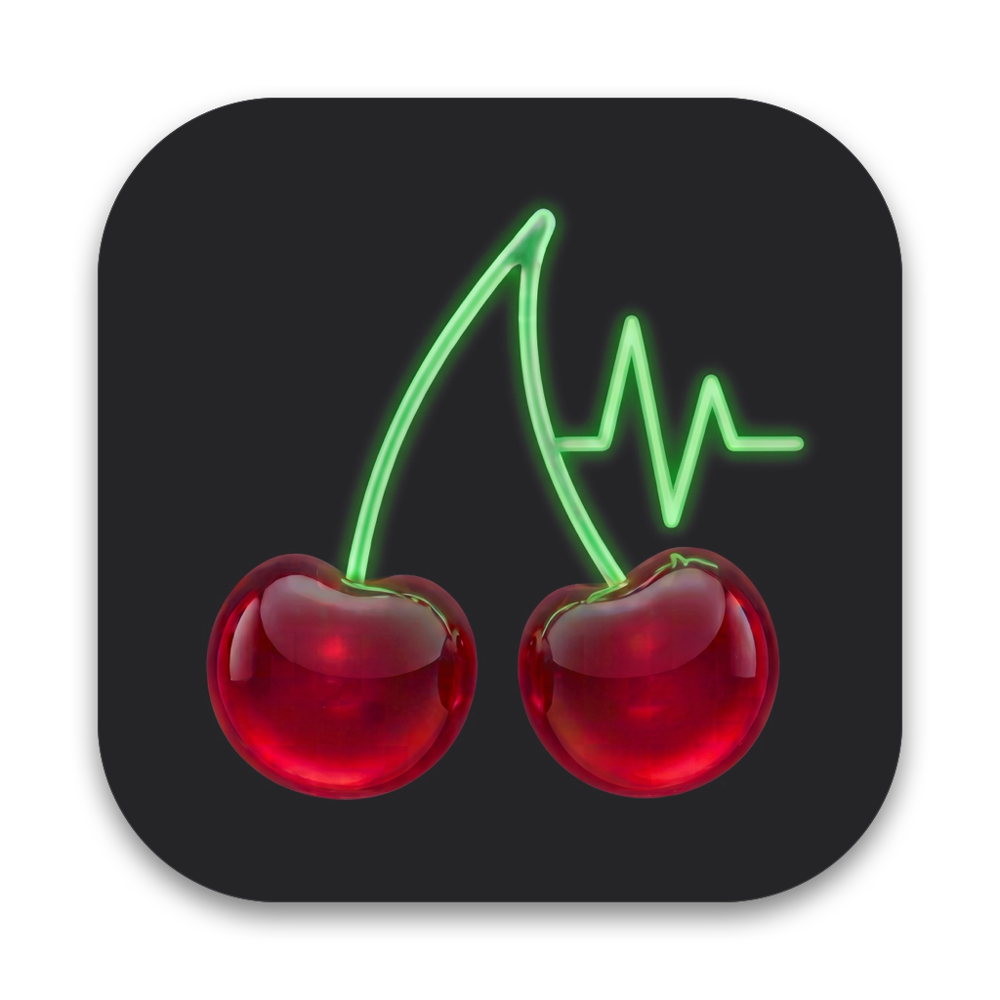

<div align="center">
  
  <h1>CherryHud 🍒⚡</h1>
  <p>
    <b>Le HUD de performance ultime pour macOS</b><br />
    <i>Propulsé par Avalonia UI, .NET 10 et les APIs système natives Apple (IOKit, ScreenCaptureKit, AppleSMC).</i>
  </p>

  <p>
    <a href="#-métriques--fonctionnalités"></a>
    <a href="#-compilation--lancement"></a>
    <a href="LICENSE"></a>
  </p>
</div>

---

## 🎮 Présentation

**CherryHud** est un overlay de performances en jeu léger, transparent et fluide conçu spécifiquement pour **macOS**. Il affiche les métriques vitales de votre Mac en temps réel sans jamais perturber votre session de jeu :

- **Superposition au-dessus des jeux plein écran** (World of Warcraft, Baldur's Gate 3, Final Fantasy XIV, émulateurs, etc.) grâce au niveau de fenêtre `NSScreenSaverWindowLevel` et au comportement `NSWindowCollectionBehaviorFullScreenAuxiliary`.
- **Zéro interruption de jeu** : isolation native (`NSApplication` swizzling) pour ne jamais voler le focus clavier/souris ni invoquer intempestivement le Dock ou la barre des menus lors des clics.
- **Rendu graphique 100% transparent** : carte sombre translucide sans bordure parasite, avec texte net et contrasté en police 16px bold pour une lisibilité parfaite en pleine action.

---

## ✨ Métriques & Fonctionnalités

### 🕹️ En-tête de session
- **Application / Jeu actif** : Détection automatique du nom du jeu au premier plan.
- **Batterie** : Pourcentage et statut de charge (`🔋 85%` ou `⚡ 85%`).
- **Horloge système** : Heure en temps réel (`HH:mm:ss`).

### 🔴 GPU (Coral)
- **Charge GPU (%)** : Taux d'utilisation effectif du processeur graphique via `IOAccelerator`.
- **Température GPU** en temps réel lue directement dans les registres SMC matériels (`AppleSMC`).
- **VRAM Allouée** : Quantité de mémoire vidéo active (en Go).

### 🔵 CPU (Cyan)
- **Charge CPU (%)** : Utilisation globale des cœurs processeur via l'API Mach du noyau macOS.
- **Température CPU** en temps réel via `AppleSMC` natif.

### 🟣 RAM (Royal Blue)
- **Consommation Mémoire** : Mémoire vive utilisée (en Go).

### 🟢 FPS & Frametime (Lime Green)
- **Compteur de FPS réel** (`ScreenCaptureKit`) filtré sur les trames effectives (`SCFrameStatusComplete`).
- **Temps de trame (*Frametime*)** mesuré trame par trame en millisecondes (ex. `16.6 ms` à 60 FPS, `8.3 ms` à 120 FPS).
- **Graphique Frametime épuré (Sparkline néon)** :
  - Historique fluide de 7,5 secondes (mise à jour à 100 ms).
  - Ligne néon vert pur (`#00E676`) avec point lumineux de tête pour visualiser instantanément la régularité du *frame pacing* et les micro-saccades (*stutters*).

---

## 🎛️ Contrôles & Intégration macOS

- **Détection Automatique des Jeux (Zéro voyant sur le bureau)** :
  - **En jeu** : L'overlay apparaît automatiquement et démarre la mesure des FPS/frametimes en temps réel.
  - **Hors jeu (bureau, navigateur, travail)** : **La capture s'arrête immédiatement** (le voyant d'enregistrement d'écran de macOS s'éteint) et l'overlay se masque automatiquement sans aucune intervention.
- **Déplacement libre** : Glissez-déposez la fenêtre n'importe où sur votre écran.
- **Icône dans la barre des menus (TrayIcon)** :
  - **Afficher / Masquer** : Permet de forcer manuellement l'affichage ou le masquage du HUD.
  - **Mode Auto (En jeu uniquement)** : Réactive le mode automatique.
  - **Quitter CherryHud** : Ferme proprement l'application.
- **Raccourcis clavier** :
  - <kbd>Cmd</kbd> + <kbd>Q</kbd> : Ferme l'application.

---

## 🔒 Autorisation macOS (Enregistrement de l'écran)

Pour que macOS autorise le widget à capturer les trames effectives de l'écran pour calculer les FPS sans aucun bridage :
1. Lancez **CherryHud**.
2. Si la ligne FPS affiche `Perm. requise`, cliquez dessus ou rendez-vous dans :  
   **Réglages Système > Confidentialité et sécurité > Enregistrement de l'écran**.
3. Activez l'autorisation pour l'application ou le terminal exécutant l'application. Cette validation ne s'effectue qu'une seule fois.

---

## 🚀 Compilation & Lancement

### Prérequis
- macOS 13.0+ (Ventura, Sonoma, Sequoia) sur Mac Apple Silicon (M1/M2/M3/M4) ou Intel.
- SDK .NET 10.0+.
- Clang / Xcode Command Line Tools (`xcode-select --install`).

### Lancer en ligne de commande

```bash
# Compilation et lancement direct
dotnet run --project MacTemp/MacTemp.csproj
```

---

## 📜 Licence

Ce projet est distribué sous licence [MIT](LICENSE).
