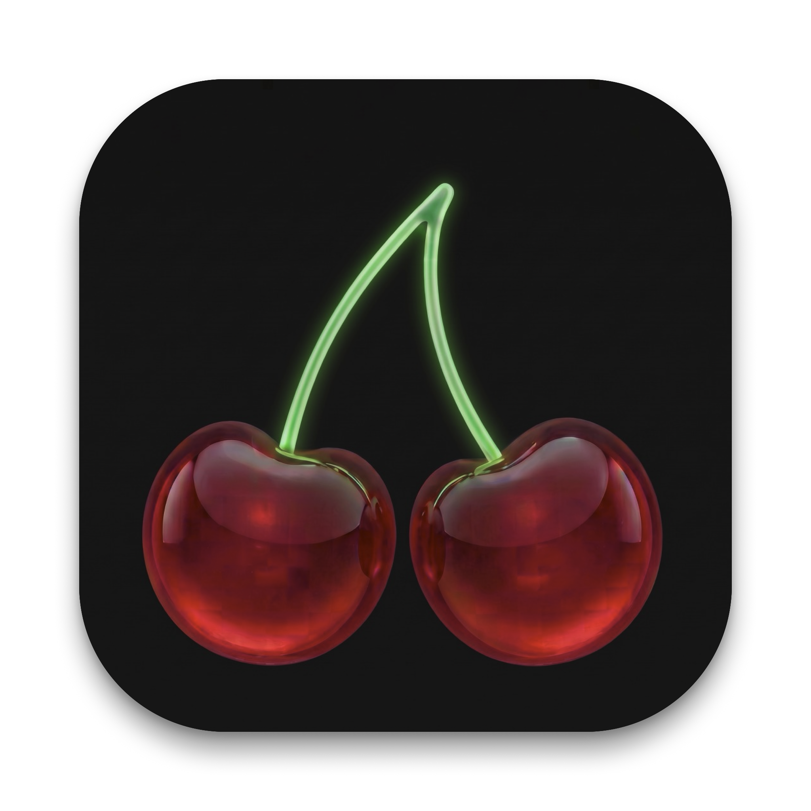
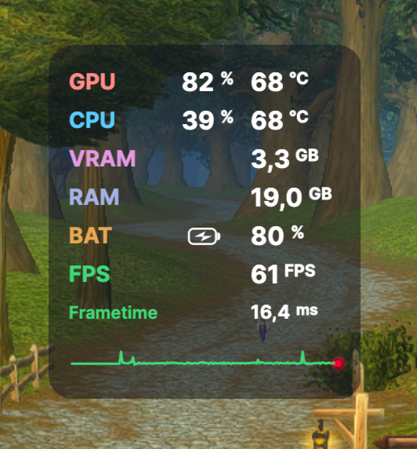

<div align="center">
  
  <h1>CherryHud 🍒⚡</h1>
  <p>
    <b>The Ultimate Gaming Performance HUD for macOS</b><br />
    <i>Powered by Avalonia UI, .NET 10, and native Apple system APIs (IOKit, ScreenCaptureKit, AppleSMC).</i>
  </p>

  <p>
    <a href="#-metrics--features"></a>
    <a href="#-compilation--running"></a>
    <a href="#-compilation--running"></a>
    <a href="LICENSE"></a>
  </p>

  <br />
  <p align="center">
    
  </p>
</div>

---

## 🎮 Overview

**CherryHud** is a lightweight, translucent, and fluid in-game performance overlay designed specifically for **macOS**. It displays vital hardware metrics for your Mac in real time without ever disrupting your gameplay:

- **True Full-Screen Game Overlay**: Floats seamlessly over full-screen Metal games (*World of Warcraft*, *Baldur's Gate 3*, *Final Fantasy XIV*, *Cyberpunk 2077*, emulators, etc.) utilizing `NSScreenSaverWindowLevel` and `NSWindowCollectionBehaviorFullScreenAuxiliary`.
- **Zero Input Interference**: Native AppKit isolation prevents the overlay from ever stealing keyboard or mouse focus, and suppresses unwanted Dock or menu bar popups during frantic gaming sessions.
- **Clean Translucent Rendering**: Translucent dark card with no border clutter, crisp white typography for all numbers and units, and distinctive category badges for effortless at-a-glance readability in the heat of action.

---

## ✨ Metrics & Features

### 🔴 GPU (Coral)
- **GPU Utilization (%)**: Real-time graphics load obtained directly through `IOAccelerator`.
- **GPU Temperature**: Hardware temperatures read directly from native `AppleSMC` registers.
- **Dedicated VRAM**: Active allocated video memory (in GB).

### 🔵 CPU (Sky Blue)
- **CPU Load (%)**: Overall processor core utilization queried via macOS Mach kernel APIs.
- **CPU Temperature**: Instantaneous processor die temperature via native `AppleSMC`.

### 🟣 VRAM & RAM (Lavender & Periwinkle)
- **VRAM / GPU Memory**: Active VRAM consumption in GB (customizable label: *VRAM* or *GPU MEM*).
- **RAM**: Real-time system physical memory consumption in GB.

### 🟡 Battery (Amber)
- **Battery Percentage & Status**: Current charge percentage and charging state indicator (`🔋` / `⚡`). Automatically hidden on desktop Macs without battery.

### 🟢 FPS & Frametime (Mint Green)
- **Hardware-Accurate FPS Counter**: Powered by Apple's `ScreenCaptureKit`, strictly filtered on completed frame presentations (`SCFrameStatusComplete`).
- **Dedicated Frametime Row**: Instantaneous frame delivery time measured down to the millisecond (`ms`), positioned right above the graph.
- **Frametime Sparkline Graph**:
  - Live rolling buffer capturing frame delivery regularity.
  - Stem green line sampled from the logo (`#70D078`) with a glowing ruby cherry dot (`#D41630`) at the leading edge to instantly spot stutter, frame spikes, or pacing inconsistencies.

---

## 🎛️ Controls & macOS Integration

- **Automatic Game Detection (Zero Indicator on Desktop)**:
  - **In-Game**: The overlay appears automatically and immediately begins measuring FPS and hardware metrics.
  - **Out of Game (Desktop, Browser, Work)**: **Capture stops instantly** (the macOS screen recording privacy indicator turns off), and the overlay automatically hides without manual intervention.
- **Drag & Placement**: Click and drag the overlay card to position it anywhere, or select automatic corner anchoring in Settings (*Top-Left*, *Top-Right*, *Bottom-Left*, *Bottom-Right*).
- **Menu Bar Tray Icon**:
  - **Show / Hide**: Manually toggle overlay visibility.
  - **Auto Mode (In-Game Only)**: Toggle automatic game detection.
  - **Settings...**: Open the centralized preferences and About window.
  - **Quit CherryHud**: Cleanly shut down the application (<kbd>Cmd</kbd> + <kbd>Q</kbd>).

---

## ⚙️ Settings Window

CherryHud includes a comprehensive settings window with four dedicated tabs:
1. **Display**: Auto-game mode toggle, screen corner placement, and opacity slider (40% to 100%).
2. **Metrics**: Granular toggles for GPU, CPU, VRAM, RAM, Battery, FPS, and the Frametime Graph.
3. **Advanced**: VRAM naming convention, sparkline animation refresh rate, and direct shortcut to macOS Security & Privacy settings.
4. **About**: Official application icon, release version, summary of features, credits, and MIT license.

---

## 🔒 macOS Permissions (Screen Recording)

To calculate exact frame delivery times and FPS without display server throttle, macOS requires Screen Recording permission:
1. Launch **CherryHud**.
2. If the FPS line displays `Perm. required`, click on it or navigate to:  
   **System Settings > Privacy & Security > Screen Recording**.
3. Enable the permission toggle for **CherryHud** (or your Terminal / IDE if launching from source). This is required only once.

---

## 🚀 Compilation & Running

### Prerequisites
- macOS 13.0+ (Ventura, Sonoma, Sequoia) on Apple Silicon (M1/M2/M3/M4) or Intel Mac.
- [.NET 10.0+ SDK](https://dotnet.microsoft.com/download/dotnet/10.0).
- Xcode Command Line Tools (`xcode-select --install`).

### Build & Run

```bash
# Clone the repository
git clone https://github.com/MathieuRicard/MacTemp.git
cd MacTemp

# Build and launch CherryHud
dotnet run --project CherryHud/CherryHud.csproj
```

---

## 📜 License

This project is licensed under the [MIT License](LICENSE).
